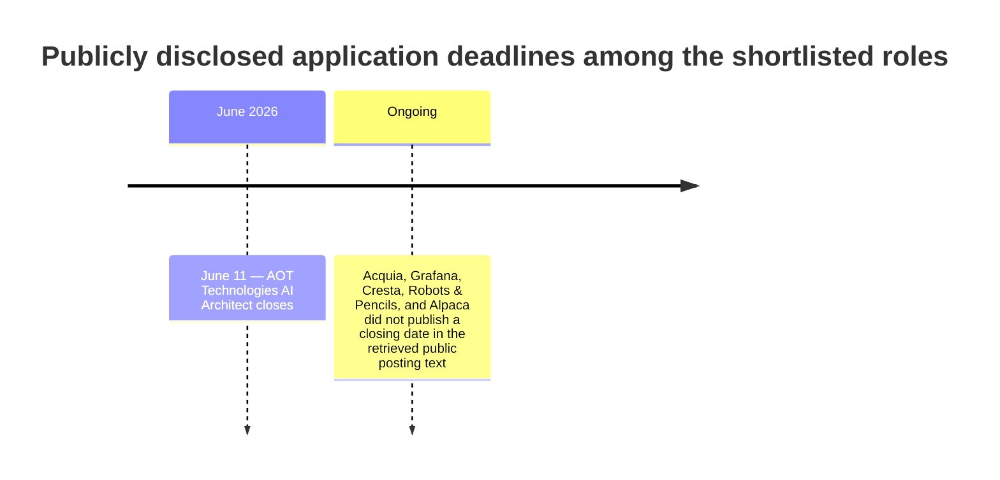

# Remote AI Agent Job Market Report

## Table of contents

- [Executive summary](#executive-summary)
- [Research scope and selection logic](#research-scope-and-selection-logic)
- [Deadline timeline](#deadline-timeline)
- [Top prioritized roles](#top-prioritized-roles)
- [Tailored application kits](#tailored-application-kits)
- [Cross-role application patterns](#cross-role-application-patterns)

## Executive summary

I screened current official postings for roles that explicitly reward the exact capabilities behind an **AI agent orchestration layer**: multi-agent orchestration, tool and function calling, RAG, human-in-the-loop controls, runtime or state management, integrations, and observability. The strongest current matches are concentrated in **Canada-remote** or **North America remote** roles at Acquia, Cresta, Grafana, AOT Technologies, Alpaca, and Robots & Pencils. These postings are unusually aligned because they name the underlying mechanics directly rather than asking for vague “AI experience.” citeturn21view4turn23view3turn24view0turn24view4turn20view4turn26view0turn21view1

If you want the shortest path to a highly tailored application, the top three are **Acquia Staff AI Engineer**, **Cresta Senior Software Engineer, Backend, AI Agent Runtime**, and **Grafana Staff AI Engineer in Revenue Operations**. Acquia is the closest lexical match to a pure orchestration-layer builder because it explicitly asks for LangGraph, Temporal, Pydantic, LangFuse, RAG, tool-calling, persistent runtimes, and human-in-the-loop design. Cresta’s runtime role is the best fit if your layer is strongest on **state, runtime, orchestration, autoscaling, observability, and developer tooling**. Grafana’s Revenue Operations role is the best fit if your layer can be demonstrated as **business workflow automation** across Slack, CRMs, email, calendars, APIs, MCP servers, and self-service agentic workflows. citeturn21view4turn20view0turn24view0turn24view1turn23view3turn21view3

One notable screening result: I excluded otherwise interesting roles when the public posting introduced a meaningful onsite constraint or did not expose enough detail to support precise tailoring. For example, Lumos’s AI Agent Engineer role mentions a “remote work culture,” but the current posting also says the role must be in San Francisco in person two to three times a week, which weakens its fit for your remote-first requirement. citeturn15view3

## Research scope and selection logic

The shortlist was built from **official company postings** and filtered for five criteria. First, the role had to be **currently accessible on an official career page**. Second, the role had to be **remote-friendly for Canada or North America**, because you asked for remote work with Canada or US remote priority. Third, the posting had to mention one or more of the technical pillars that map cleanly to an orchestration layer: **multi-agent systems, orchestration patterns, function or tool calling, RAG, state or memory management, observability or evals, runtime infrastructure, workflow automation, or human escalation and governance**. Fourth, I favored roles where public text was rich enough to produce a tailored cover letter and resume strategy. Fifth, I prioritized roles where the organization itself made the AI work central to the team’s mission, not incidental. citeturn21view4turn23view3turn24view0turn24view4turn20view4turn26view0turn21view1

That filter yielded two dominant buckets. One bucket is **core agent systems engineering**, represented by Acquia, Cresta, and Alpaca: these roles care most about durable stateful workflows, runtime control, evaluation, governance, security, and infra patterns. The other bucket is **agentic workflow automation inside business systems**, represented by Grafana, AOT, and Robots & Pencils: these roles care most about integrating models into operational workflows, building tool access and retrieval pipelines, and shipping reliable automations into real organizational environments. citeturn21view4turn24view0turn24view4turn26view0turn23view3turn20view4turn21view1

## Deadline timeline

Among the eight shortlisted roles, **AOT Technologies AI Architect** is the only posting in this set that publicly disclosed a closing date, which is **June 11, 2026**. The other official postings did not state a public deadline in the retrieved posting text, so they should be treated as rolling until proven otherwise. citeturn23view0turn23view1turn22view0turn22view1turn22view2turn22view3turn22view4turn22view5

## Top prioritized roles

| Priority | Company | Role | Official posting | Remote policy | Why it matches your orchestration layer |
|---|---|---|---|---|---|
| High | Acquia | Staff AI Engineer | [Official posting](https://job-boards.greenhouse.io/acquia/jobs/7821888) | Remote-Canada. citeturn21view4 | Best pure match for stateful multi-agent workflows, LangGraph, Temporal, Pydantic, LangFuse, RAG, tool-calling, persistent runtimes, and HITL. citeturn21view4turn20view0 |
| High | Cresta | Senior Software Engineer, Backend, AI Agent Runtime | [Official posting](https://job-boards.greenhouse.io/cresta/jobs/4675293008) | Canada remote; compensation is base salary + equity + benefits, but no public range. citeturn6view4turn24view1 | Strongest runtime-and-state role: LLM streaming, conversation state, checkpointing, crash recovery, function execution runtime, autoscaling, observability. citeturn24view0turn24view1 |
| High | Grafana Labs | Staff AI Engineer, Revenue Operations | [Official posting](https://job-boards.greenhouse.io/grafanalabs/jobs/5839190004) | Remote, Canada time zones only. citeturn23view3 | Best business-automation version of your layer: MCP servers, APIs, RAG, multi-agent systems, workflow orchestration, monitoring, HITL, self-service enablement. citeturn23view3turn21view3 |
| High | AOT Technologies | AI Architect | [Official posting](https://job-boards.greenhouse.io/aottechnologies/jobs/5228675008) | Remote Canada, optional hybrid in Victoria; salary CAD 120,000–140,000; closes June 11, 2026. citeturn23view0turn23view1 | Strong architect/consulting fit for tool calling, memory and state, RAG, orchestration frameworks, cloud delivery, and regulated enterprise workflows. citeturn20view4turn20view5 |
| High | Alpaca | Senior AI Platform Engineer | [Official posting](https://job-boards.greenhouse.io/alpaca/jobs/5993920004) | Remote North America, EST. citeturn26view0 | Excellent AI platform/governance fit: connectors, execution environments, tool-access isolation, approvals, audit trails, observability, AI enablement at scale. citeturn26view0 |
| Medium-high | Cresta | Senior Software Engineer, Backend, AI Agent Integrations | [Official posting](https://job-boards.greenhouse.io/cresta/jobs/4918465008) | Canada remote; base salary + equity + benefits, but no public range. citeturn6view5turn23view4 | Best integrations-and-handoff role: CCaaS APIs, context propagation, real-time state, AI-to-human transfer, low latency, observability, enterprise security. citeturn24view4turn24view5 |
| Medium-high | Acquia | Enterprise AI Architect | [Official posting](https://job-boards.greenhouse.io/acquia/jobs/7852641) | Remote-Canada. citeturn15view0 | More architect-facing version of the Acquia stack: production AI code, LangGraph, Temporal, Pydantic, LangFuse, RAG blueprints, organizational standards. citeturn15view0turn15view1 |
| Medium-high | Robots & Pencils | Staff AI Engineer | [Official posting](https://job-boards.greenhouse.io/robotsandpencils/jobs/5227351008) | Canada remote; one in-person interview and one-week on-site onboarding, both covered; salary CAD 155,000–215,000. citeturn21view1 | Best consultancy-style builder role for Python/Node, function calling, multi-agent orchestration, OpenSearch embeddings, serverless AWS workflows, Langfuse, and synthetic testing. citeturn20view2turn20view3turn21view1 |

## Tailored application kits

**Acquia — Staff AI Engineer**

| Field | Details |
|---|---|
| Company | Acquia. The posting frames Acquia as a digital experience platform building for “every audience, human or otherwise,” with AI capabilities across its Drupal-based DXP. citeturn21view4 |
| Role | Staff AI Engineer. citeturn21view4 |
| Official posting | [https://job-boards.greenhouse.io/acquia/jobs/7821888](https://job-boards.greenhouse.io/acquia/jobs/7821888) |
| Location / remote policy | Remote-Canada. citeturn21view4 |
| Salary | Unspecified in public posting text. |
| Application deadline | Unspecified in public posting text. |
| Required qualifications | 8+ years in software engineering, 3+ years in production AI agents, hands-on LangGraph, Temporal, Pydantic, LangFuse, agent frameworks such as LangChain/LlamaIndex/CrewAI, deep Python, cloud AI deployment, and RAG architecture knowledge. citeturn21view4turn20view0 |
| Preferred qualifications | Enterprise SaaS or CMS, Drupal DXP familiarity, persistent agent runtimes, LLM fine-tuning or evaluation, human-in-the-loop design, and strong communication with both engineers and executives. citeturn20view0 |
| Key responsibilities | Ship production AI code daily; architect stateful multi-agent workflows; own LangFuse observability; set standards for RAG, prompt management, context optimization, and tool-calling; partner with product and platform; benchmark emerging tooling; mentor through engineering work; support customer architectural reviews. citeturn21view4 |
| Tech stack / tools | LangGraph, Temporal, Pydantic, LangFuse, LangChain, LlamaIndex, CrewAI, Python, cloud AI deployment, containerization, vector DBs, embeddings, retrieval pipelines. citeturn21view4turn20view0 |
| Team / manager context | AI Core Engineering team; role is primarily hands-on, with light but meaningful mentoring; cross-functional with product and platform; customer-facing architecture involvement; team size and manager unspecified. citeturn21view4 |

**Tailored resume bullets**

- Built an AI agent orchestration layer in **[your stack]** that coordinates **[N] specialized agents**, tool/function calls, retrieval, memory, and approval gates across multi-step workflows, positioning the work for **LangGraph/Temporal-style stateful orchestration**.
- Designed observability and evaluation loops for non-deterministic AI systems, including **trace capture, failure analysis, prompt iteration, and regression tests**, improving task success from **[baseline] to [target]** and reducing silent failures by **[X%]**.
- Implemented **RAG, context optimization, structured tool use, and fallback logic** for production-facing workflows while enforcing enterprise controls such as **role-based access, audit logging, and HITL escalation**.
- Drove technical direction on agent architecture and reliability standards, producing reusable abstractions for **memory, tool invocation, runtime state, and model benchmarking** that accelerated new workflow launches by **[X%]**.

**Tailored cover letter draft**

I’m applying because Acquia’s Staff AI Engineer role is unusually close to the system I’ve already built: an AI agent orchestration layer designed to coordinate specialized agents, retrieval, tool calls, state, and human approval paths in production workflows. The posting’s emphasis on **LangGraph, Temporal, Pydantic, LangFuse, RAG, and enterprise reliability** maps directly to the engineering problems I care most about solving.

My strongest contribution would be bringing orchestration-layer thinking into Acquia’s AI Core Engineering team. I’ve focused on the hard parts that sit behind agent demos: durable multi-step execution, runtime state, traceability, evaluation, retrieval quality, approval interrupts, and the patterns that make agent behavior observable and trustworthy. I would be excited to adapt those capabilities into Acquia’s DXP environment, helping define reusable standards for agent design, context management, observability, and production rollout.

Acquia is clearly moving from experimentation toward durable agentic infrastructure, and that transition is exactly where I can add leverage. I’d welcome the opportunity to discuss how my orchestration layer experience can help Acquia scale production-grade AI workflows across the platform.

**ATS keywords**

LangGraph, Temporal, Pydantic, LangFuse, multi-agent workflows, stateful orchestration, RAG, tool-calling, retrieval pipelines, prompt management, context optimization, Python, enterprise reliability, human-in-the-loop, persistent runtimes, AI observability.

**Suggested portfolio/demo**

Attach a **“stateful multi-agent workflow”** demo: architecture diagram, execution trace screenshots, eval dashboard, and a short video showing a task moving through retrieval, tool calls, memory updates, failure handling, and human interruption. For Acquia, emphasize **traceability**, **enterprise guardrails**, and a **reusable orchestration blueprint**.

**Interview prep focus**

Expect deep discussion on **stateful workflow design**, **LangGraph-equivalent abstractions**, **observability and evals**, and how you would define organization-wide engineering standards for agent systems.

| Likely question | Ideal talking points |
|---|---|
| How would you map your orchestration layer to LangGraph and Temporal? | Actor/state model, durable execution, retries, checkpoints, interrupt points, task graph semantics. |
| How do you decide when an agent should call a tool versus reason longer? | Cost-latency-quality tradeoffs, confidence thresholds, tool schemas, fallback path design. |
| How do you evaluate a multi-agent workflow before production? | Golden datasets, task-level scorers, regression suites, adversarial cases, shadow mode. |
| What would you instrument in LangFuse first? | Trace spans, tool-call metadata, latency, token cost, failure taxonomy, user outcome. |
| How do you prevent retrieval from polluting context windows? | Query rewriting, source ranking, chunk hygiene, freshness rules, selective context packing. |
| What does a good HITL interrupt model look like? | Clear escalation triggers, approval checkpoints, reversible actions, auditability. |
| How do you handle persistent memory safely? | Scope boundaries, TTL, write policies, provenance, user-level isolation. |
| What design patterns should Acquia standardize? | Tool schema conventions, state contracts, eval templates, model routing, fallback policy. |
| How do you benchmark providers or frameworks? | Fixed eval set, cost/latency matrices, failure analysis, operational fit, lock-in risk. |
| How would you explain this system to an executive? | Reliability, governance, measurable business outcomes, deployment path, risk controls. |

**Cresta — Senior Software Engineer, Backend, AI Agent Runtime**

| Field | Details |
|---|---|
| Company | Cresta. The company positions itself as a unified AI platform for conversational AI agents, human agent augmentation, and conversation intelligence, serving brands such as United Airlines, Cox Communications, and Marriott. citeturn6view4 |
| Role | Senior Software Engineer, Backend, AI Agent Runtime. citeturn6view4 |
| Official posting | [https://job-boards.greenhouse.io/cresta/jobs/4675293008](https://job-boards.greenhouse.io/cresta/jobs/4675293008) |
| Location / remote policy | Canada remote. Cresta notes compensation includes salary, equity, and benefits, but no public range is disclosed. citeturn6view4turn24view1 |
| Salary | Base salary + equity + benefits; exact range unspecified publicly. citeturn24view1 |
| Application deadline | Unspecified in public posting text. |
| Required qualifications | 5+ years in software engineering with infrastructure/platform/systems depth; strong Python and Go; distributed systems, Kubernetes, developer tooling, strong code quality, on-call ownership, and AI-native development workflows. citeturn24view0turn24view1 |
| Preferred qualifications | Real-time voice or streaming systems, LLM integration, serverless or FaaS platforms, workflow engines such as Temporal/Argo/Airflow, conversational AI, and IaC/GitOps. citeturn24view0turn24view3 |
| Key responsibilities | Build low-latency stateful runtime for voice/chat agents, session management, checkpointing, crash recovery, custom logic execution runtime, autoscaling, versioned rollouts, DevEx and test tooling, observability and incident response. citeturn24view0turn7view4 |
| Tech stack / tools | Python, Go, Kubernetes, LLM streaming, session state, checkpointing, serverless-style execution, Temporal/Argo/Airflow as relevant nice-to-haves, observability tooling. citeturn24view0turn24view3 |
| Team / manager context | AI Agent team; mission is production-grade practical AI agents for customer experience; company founded out of the Stanford AI Lab; CEO previously led Google’s Contact Center AI and Vertex AI platforms; team size and manager unspecified. citeturn6view4turn7view4 |

**Tailored resume bullets**

- Built a production orchestration runtime that maintained **conversation or task state across multi-step executions**, with retries, checkpoints, audit logs, and failure recovery that improved workflow completion by **[X%]**.
- Engineered **tool execution infrastructure** for custom functions and external APIs, including **sandboxing, autoscaling, versioned deployment, and rollback paths**, reducing release risk by **[X%]**.
- Designed observability for agent runtimes with **trace logs, latency histograms, failure taxonomies, and incident debugging hooks**, cutting mean-time-to-detect or diagnose by **[X%]**.
- Developed developer-facing tooling such as **local runtime emulators, CLI deploy flows, or test harnesses**, shrinking iteration time from **[A] to [B]**.

**Tailored cover letter draft**

Cresta’s AI Agent Runtime role stood out because it focuses on the exact layer beneath agent behavior that most teams underinvest in: **state, execution, recovery, and production ownership**. I’ve been building an orchestration layer around those same concerns, treating agents as systems that need durable runtime semantics, not just clever prompts.

My background is strongest where Cresta is placing its bet: session state, tool execution, retries, approval boundaries, observability, and developer ergonomics. I’ve worked on the runtime concerns that make higher-level agent behavior dependable in practice, including stateful execution, failure recovery, traceability, and abstractions that let new workflows ship quickly without sacrificing operational control. That experience would translate well to Cresta’s voice and chat runtime, especially around LLM streaming, checkpointing, and safe rollout patterns.

I’d be excited to bring an orchestration-minded systems approach to Cresta’s AI Agent team and help raise the runtime bar for speed, reliability, and operability. I’d welcome the chance to discuss how I would evolve Cresta’s execution platform for real production workloads.

**ATS keywords**

AI agent runtime, stateful runtime, LLM streaming, conversation state, checkpointing, crash recovery, distributed systems, Python, Go, Kubernetes, autoscaling, function execution platform, observability, incident response, developer tooling, Temporal.

**Suggested portfolio/demo**

Attach a **runtime reliability dossier**: one architecture page plus a short screencast showing a workflow under failure, restart, and retry. Include p95 latency, failure taxonomy, rollback or versioning strategy, and how state survives worker restarts.

**Interview prep focus**

This role will likely test whether you think like a **runtime engineer** rather than an app engineer: consistency, concurrency, state ownership, rollout safety, and low-latency operations.

| Likely question | Ideal talking points |
|---|---|
| How would you model session state for live AI conversations? | Explicit state machine, durable storage, event sourcing or checkpoints, conflict handling. |
| What breaks when workers scale horizontally? | Affinity, duplicate execution, race conditions, checkpoint consistency, idempotency. |
| How would you design a customer function execution runtime? | Isolation, resource limits, versioning, rollback, secrets, audit logs. |
| How do you support low latency without losing reliability? | Hot paths, async boundaries, backpressure, timeouts, degradations, fallbacks. |
| What should be observable in an agent runtime? | State transitions, streaming spans, tool latency, queue depth, retry outcomes. |
| How would you test crash recovery? | Fault injection, replay tests, chaos scenarios, partial writes, resumability assertions. |
| Why use Go and Python together here? | Control plane vs runtime tradeoffs, ecosystem fit, performance, operational simplicity. |
| How do you roll out a runtime change safely? | Canary, version pinning, dual writes, shadow traffic, rollback triggers. |
| What are the biggest risks in real-time voice agents? | Timing, partial utterances, streaming errors, handoff delays, state corruption. |
| How do AI coding tools fit your workflow? | Faster iteration, but strong tests, code review, trace-driven debugging. |

**Grafana Labs — Staff AI Engineer, Revenue Operations**

| Field | Details |
|---|---|
| Company | Grafana Labs. The posting says Grafana has 35 million+ users, 7,000+ customers, and is a 100% remote company with 1,600+ team members in 40+ countries. citeturn23view3 |
| Role | Staff AI Engineer, Revenue Operations. citeturn23view3 |
| Official posting | [https://job-boards.greenhouse.io/grafanalabs/jobs/5839190004](https://job-boards.greenhouse.io/grafanalabs/jobs/5839190004) |
| Location / remote policy | Remote, Canada time zones only. citeturn23view3 |
| Salary | Unspecified in public posting text. |
| Application deadline | Unspecified in public posting text. |
| Required qualifications | 8+ years in software engineering, 2+ years applying LLMs to production workflows, Python and JavaScript/Node.js, prompt engineering, RAG, function calling, structured outputs, evaluation, multi-agent systems at scale, GCP, BigQuery, Cloud Functions/Cloud Run, understanding of LLM failure modes, and AI-assisted development fluency. citeturn21view3 |
| Preferred qualifications | The public posting frames business-problem diagnosis, high-autonomy execution, and clear communication as essential. No separate preferred section is listed. citeturn23view3turn21view3 |
| Key responsibilities | Own multi-agent GTM infrastructure, build modular agent systems, reusable agentic skills, observability and governance loops, MCP servers, APIs, CLIs, microservices, RAG pipelines, workflow automations, and self-service enablement across Sales, Customer Success, and Marketing. citeturn23view3turn7view1turn7view2 |
| Tech stack / tools | LangChain, CrewAI, Anthropic MCP, BigQuery, Slack, CRMs, email, calendars, analytics tools, GCP Cloud Functions, Cloud Run, n8n, Workato, Python, Node.js, Claude Code, Gemini CLI, OpenAI Codex. citeturn7view1turn7view2turn21view3 |
| Team / manager context | Revenue Operations org powering GTM teams; partners with Data Engineering, GTM Systems, Field Operations, and GTM leadership; high-autonomy role; manager and team size unspecified. citeturn23view3 |

**Tailored resume bullets**

- Built an AI orchestration layer that connected **Slack, CRM, email, calendar, knowledge sources, and internal APIs**, automating multi-step go-to-market or operational workflows and reducing manual processing by **[X%]**.
- Implemented **multi-agent routing patterns** including router-dispatcher, sequential chains, and parallel fan-out, with state tracking, cost controls, fallback logic, and human escalation for production reliability.
- Created **MCP-like tool interfaces or standardized tool schemas** that let agents safely invoke reusable skills across internal applications, cutting custom integration time by **[X%]**.
- Deployed **RAG-backed workflow services** on **[GCP/AWS]** with test coverage, CI/CD, metrics, trace logs, and self-serve documentation that increased adoption across partner teams by **[X%]**.

**Tailored cover letter draft**

Grafana’s Revenue Operations AI role is compelling because it treats agent systems as operational infrastructure rather than side projects. That matches how I’ve approached my own work: I built an orchestration layer to connect models, tools, retrieval, and humans into workflows that actually move work across systems.

What I would bring to Grafana is a proven approach to converting messy business processes into reliable agentic services. My layer is built around modular tool access, orchestration patterns, runtime state, observability, and escalation logic, which lines up closely with Grafana’s focus on MCP servers, APIs, RAG pipelines, multi-agent architectures, and self-service workflow platforms for GTM teams. I’m especially excited by the chance to apply those patterns to high-leverage Revenue Operations problems where business impact is measurable and immediate.

Grafana’s combination of deep observability culture and high-autonomy AI platform building is rare. I’d welcome the chance to discuss how I could help build agent systems that are useful, governed, and adopted across Revenue Operations.

**ATS keywords**

Revenue Operations, GTM automation, multi-agent systems, MCP servers, APIs, CLIs, microservices, RAG, function calling, structured outputs, Python, Node.js, BigQuery, Cloud Functions, Cloud Run, n8n, Workato, observability, human escalation.

**Suggested portfolio/demo**

Attach a **GTM workflow automation demo**: show inbound request triage, account enrichment, CRM update, email draft, calendar booking, and escalation to a human. Include a trace view with token cost, latency, and fallback logic.

**Interview prep focus**

Prepare to speak in **workflow language**, not only model language. Grafana wants someone who can diagnose **business bottlenecks**, not just engineer agents.

| Likely question | Ideal talking points |
|---|---|
| How do you decide which GTM workflow to automate first? | Volume, pain, repeatability, measurable downstream impact, data availability. |
| What orchestration pattern would you use for a lead-routing workflow? | Router + specialized agents + confidence policy + human fallback. |
| How would you design an MCP server in this environment? | Stable contracts, permission scoping, audit logs, reusable actions, tooling discoverability. |
| How do you keep RAG grounded in live business context? | Freshness boundaries, structured sources, retrieval ranking, source attribution. |
| What failure modes matter most in GTM agents? | Wrong recipients, stale CRM state, poor confidence calibration, hidden partial failures. |
| How do you manage cost? | Model tiering, caching, prompt compression, selective retrieval, async batching. |
| How would you measure success? | Time saved, queue reduction, SLA compliance, adoption, acceptance rate, error rate. |
| What should partner teams be able to self-serve? | Workflow templates, tool registry, docs, dashboards, guardrailed config. |
| How do you prevent agents from overreaching? | Narrow action scopes, approvals, sandboxed writes, confidence thresholds, audit trails. |
| How would you explain agent observability to a RevOps leader? | Faster diagnosis, trust, predictable outcomes, cost visibility, continuous improvement. |

**AOT Technologies — AI Architect**

| Field | Details |
|---|---|
| Company | AOT Technologies. The posting says AOT works with enterprises, startups, and governments on mission-critical challenges and also builds products such as formsflow.ai and SLED360. citeturn6view7turn20view4 |
| Role | AI Architect. citeturn6view7 |
| Official posting | [https://job-boards.greenhouse.io/aottechnologies/jobs/5228675008](https://job-boards.greenhouse.io/aottechnologies/jobs/5228675008) |
| Location / remote policy | Remote Canada, optional hybrid in Victoria, BC. citeturn6view7turn23view0 |
| Salary | CAD 120,000–140,000. citeturn23view0turn23view1 |
| Application deadline | June 11, 2026. citeturn23view0turn23view1 |
| Required qualifications | Hands-on agentic AI application architecture; LangGraph, LangChain, Microsoft Agent Framework, Semantic Kernel, AutoGen, Google ADK, or similar; prompt and context engineering; Python/.NET/Java; tool calling with enterprise APIs and databases; memory and state management; cloud architecture; CI/CD; logging, monitoring, testing, secure deployment; RAG, vectorization, embeddings, evaluation. citeturn20view4turn20view5 |
| Preferred qualifications | MCP, A2A, tool/server integration patterns, Azure AI Foundry, full-stack experience, Docker, Kubernetes, serverless, open-source contributions, public sector/financial services/healthcare, Databricks/Fabric/Snowflake. citeturn20view5turn23view0 |
| Key responsibilities | Lead design and development of intelligent agentic applications for enterprise and government operations; translate business requirements into cloud-native AI architectures; build production-grade agentic apps; design tool calling, RAG, memory and state, and cloud delivery patterns; evolve AOT’s AI practice. citeturn20view4 |
| Tech stack / tools | LangGraph, LangChain, Microsoft Agent Framework, Semantic Kernel, AutoGen, Google ADK, Python, .NET, Java, Azure, AWS, GCP, MCP, A2A, Azure AI Foundry, Databricks, Fabric, Snowflake. citeturn20view5turn23view0 |
| Team / manager context | Client-facing architect role spanning enterprise and public-sector work; tied to consulting practice plus product lines formsflow.ai and SLED360; team size and manager unspecified. citeturn6view7turn20view4 |

**Tailored resume bullets**

- Architected an agentic workflow platform that translated ambiguous business processes into **cloud-native AI systems** with tool calling, retrieval, state management, and approval flows, reducing manual cycle time by **[X%]**.
- Built reusable orchestration patterns for **multi-turn, multi-agent workflows** that integrated with **LOB APIs, databases, and external services**, improving deployment velocity across new use cases by **[X%]**.
- Established production engineering standards for agentic systems, including **CI/CD, logging, monitoring, secure secret handling, testing, and rollback**, raising release confidence and reducing defect escape by **[X%]**.
- Led requirements discovery with stakeholders and turned process pain into architecture decisions covering **RAG, memory, context engineering, evaluation, and governance**.

**Tailored cover letter draft**

AOT’s AI Architect role is a strong fit because it blends two things I’ve been building toward: hands-on agent orchestration and practical delivery into real organizational workflows. My experience building an orchestration layer is most valuable when it is used to translate messy requirements into robust systems that can actually operate under business and compliance constraints.

The overlap with your posting is unusually specific. My work has focused on multi-agent coordination, function and tool calling, retrieval, state, observability, and human intervention points, which lines up closely with AOT’s focus on production agent frameworks, RAG, cloud-native delivery, and memory across multi-turn workflows. I would bring that experience into your consulting and product environments by helping define reusable technical patterns that work across enterprise and public-sector use cases, not just one-off demos.

AOT’s combination of client problem solving and product building is especially attractive. I’d welcome the opportunity to discuss how I could help architect agentic systems that are technically durable, operationally safe, and useful for your customers from day one.

**ATS keywords**

AI Architect, agentic AI, LangGraph, LangChain, Semantic Kernel, AutoGen, Google ADK, tool calling, function calling, RAG, memory, state management, prompt engineering, context engineering, embeddings, evaluation, Azure AI Foundry, MCP, A2A.

**Suggested portfolio/demo**

Attach a **client-facing architecture pack**: one-page problem statement, current-state process map, target-state agent architecture, security and HITL checkpoints, and a short demo of an agent workflow integrating with two external systems plus a human approval step.

**Interview prep focus**

Expect a lot of **architecture and stakeholder translation** questions. This role is about turning business ambiguity into reliable technical decisions.

| Likely question | Ideal talking points |
|---|---|
| How do you turn a client workflow into an agent design? | Process mapping, action boundaries, data sources, risk points, approval nodes. |
| When do you choose one framework over another? | State needs, tool complexity, observability, team familiarity, portability. |
| How do you design memory safely? | Separate session memory, long-term memory, policy constraints, provenance. |
| What makes an enterprise RAG architecture production-worthy? | Fresh data, retrieval quality, access control, evals, observability, cost design. |
| How do you approach public-sector constraints? | Auditability, explainability, data residency, approvals, least privilege. |
| What belongs in the first version versus later? | High-value narrow flow first, explicit controls, avoid over-autonomy early. |
| How would you incorporate MCP or A2A patterns? | Standardized tool contracts, discovery, capability routing, governance. |
| How do you validate model choice? | Eval set, domain tasks, cost/latency, failure profile, compliance constraints. |
| How do you present AI architecture to non-technical stakeholders? | Business risk, throughput gains, control points, implementation phases. |
| What standards should an AI practice define? | Logging, testing, deployment paths, tool schemas, eval gates, human reviews. |

**Alpaca — Senior AI Platform Engineer**

| Field | Details |
|---|---|
| Company | Alpaca. The posting describes Alpaca as a US-headquartered brokerage infrastructure company serving institutions in 40 countries and over 9 million brokerage accounts, with a globally distributed team of 380+ members. citeturn26view0 |
| Role | Senior AI Platform Engineer. citeturn26view0 |
| Official posting | [https://job-boards.greenhouse.io/alpaca/jobs/5993920004](https://job-boards.greenhouse.io/alpaca/jobs/5993920004) |
| Location / remote policy | Remote North America, EST. citeturn26view0 |
| Salary | Competitive salary and stock options; exact range unspecified publicly. citeturn26view0 |
| Application deadline | Unspecified in public posting text. |
| Required qualifications | 8+ years in software/platform/infrastructure; hands-on agentic AI systems; GCP; APIs, auth, OAuth, secrets, CLI tooling, deployment patterns; containers, Kubernetes, infra-as-code; AI governance controls including approvals and audit logging; strong cross-functional communication. citeturn26view0 |
| Preferred qualifications | Production agentic systems with real tool access; Google Agent Engine/Vertex AI Agent Builder; Cursor/Claude Code; sandboxing/isolation/evaluation frameworks; self-service developer platforms; startup experience; regulated-environment familiarity. citeturn26view0 |
| Key responsibilities | Own connector and service integration layer, execution environments, reusable platform services, self-service templates, AI governance layer, reliability and observability bar, escalation support, and repeatable onboarding into AI workflows. citeturn26view0 |
| Tech stack / tools | GCP, Claude SDK, Google ADK, LangGraph or similar, APIs, OAuth, secrets, CLI tooling, Kubernetes, infrastructure-as-code, audit logging, approval workflows. citeturn26view0 |
| Team / manager context | New AI Enablement function inside a larger regulated fintech; described as a “startup-inside-a-scaleup”; works closely with DevOps, Security, IT, and engineering; team size and manager unspecified. citeturn26view0 |

**Tailored resume bullets**

- Built a reusable **AI platform layer** for agents and workflows, including connectors, policy-aware tool execution, secrets management, and approval steps that let multiple teams deploy AI safely without bespoke setup.
- Designed **execution boundaries and governance controls** for higher-autonomy agents, including access scoping, audit trails, approval criteria, and operational guardrails that reduced policy risk while enabling production use.
- Created **golden paths and self-service templates** for AI workflow deployment, reducing onboarding time from **[A days] to [B days]** and cutting repeated platform work by **[X%]**.
- Implemented reliability and observability standards for AI infrastructure, including runtime metrics, trace logs, deploy checks, and evaluation hooks for autonomous workflows.

**Tailored cover letter draft**

Alpaca’s Senior AI Platform Engineer role is one of the clearest current matches for platform-minded agent work. I built my orchestration layer around the same idea your posting emphasizes: if AI use is going to scale beyond one-off experiments, teams need **connectors, execution patterns, governance, and tooling** that make safe deployment repeatable.

My experience maps closely to the capability layer Alpaca is trying to build. I’ve focused on orchestrating model calls, tools, runtime state, approvals, and observability into reusable infrastructure rather than ad hoc demos. That orientation fits well with your emphasis on connector layers, agent execution environments, isolation boundaries, access controls, self-service onboarding, and regulated deployment standards in a fintech setting.

What excites me most is the chance to help turn scattered AI experimentation into durable platform leverage. I’d welcome the opportunity to discuss how my orchestration-layer experience could help Alpaca raise the reliability, governance, and adoption bar for internal AI systems.

**ATS keywords**

AI platform engineering, agentic AI systems, GCP, Google ADK, LangGraph, connectors, execution environments, access controls, audit trails, approval workflows, governance, Kubernetes, infrastructure as code, OAuth, secrets management, observability, self-service tooling.

**Suggested portfolio/demo**

Attach a **platform governance demo**: show a workflow registry, agent sandbox or boundary model, access-control diagram, approval gate UI, and audit trail for a tool-executing agent. This role wants **platform leverage**, not just workflow cleverness.

**Interview prep focus**

This role will care about **safety, platform reuse, and regulated-environment judgment** as much as raw agent capability.

| Likely question | Ideal talking points |
|---|---|
| What is the minimum platform layer teams need for safe AI rollout? | Connectors, auth, secrets, eval hooks, approvals, observability, templates. |
| How do you isolate agents with real tool access? | Narrow scopes, environment separation, command policies, approval boundaries. |
| What should be standardized versus left flexible? | Security and deployment standards standardized; workflows and prompts flexible. |
| How do you design self-service for non-experts? | Templates, opinionated defaults, guardrails, docs, clear failure visibility. |
| What belongs in the governance layer? | Access policies, audit trails, deployment rules, escalation policy, review gates. |
| How do you evaluate platform success? | Time-to-first-workflow, adoption, reliability, support burden, security incidents. |
| How do you handle secrets and OAuth for agent tools? | Brokered access, token rotation, just-in-time credentials, scoped permissions. |
| How would you use GCP here? | Managed execution, logging, IAM, secure connectors, scalable control plane. |
| What changes in a regulated fintech environment? | Approval rigor, traceability, data handling, rollback discipline, policy alignment. |
| How do AI coding tools fit into platform work? | Productivity gains, but only with tests, policy checks, and operational review. |

**Cresta — Senior Software Engineer, Backend, AI Agent Integrations**

| Field | Details |
|---|---|
| Company | Cresta. Same company context as above: unified AI platform for customer experience and conversation intelligence, with strong enterprise customer base. citeturn6view5 |
| Role | Senior Software Engineer, Backend, AI Agent Integrations. citeturn6view5 |
| Official posting | [https://job-boards.greenhouse.io/cresta/jobs/4918465008](https://job-boards.greenhouse.io/cresta/jobs/4918465008) |
| Location / remote policy | Canada remote. Compensation is salary + equity + benefits, but exact range is not public. Cresta says it is actively hiring for the role in the US and Canada. citeturn6view5turn23view4 |
| Salary | Base salary + equity + benefits; exact range unspecified publicly. citeturn23view4 |
| Application deadline | Unspecified in public posting text. |
| Required qualifications | Bachelor’s degree, 5+ years building scalable backend systems, API design, distributed systems, real-time communication architectures, third-party enterprise integrations, Kubernetes, Docker, cloud platforms, observability, security; CCaaS and AI agents are strong pluses. citeturn24view5 |
| Preferred qualifications | CCaaS/contact center experience and familiarity with AI agents or LLM-based systems are listed as pluses rather than hard requirements. citeturn24view5 |
| Key responsibilities | Integrate AI agents with CCaaS platforms, manage real-time conversation state and session lifecycle, build AI-to-human handoff, develop voice/chat/messaging/routing integrations, collaborate with ML engineers, ensure low latency and observability, implement auth/compliance/security. citeturn24view4turn24view5 |
| Tech stack / tools | REST, gRPC, CCaaS APIs, Kubernetes, Docker, AWS/GCP/Azure, real-time conversation systems, context propagation, low-latency architectures. citeturn24view5 |
| Team / manager context | AI Agent team; deeply integration-focused role at the intersection of distributed systems, enterprise APIs, and agent orchestration; partners with ML engineers and AI researchers; team size and manager unspecified. citeturn24view4turn24view5 |

**Tailored resume bullets**

- Built an orchestration layer that integrated AI workflows with **[CRM/helpdesk/telephony/workflow] APIs**, preserving context and action history across handoffs and reducing rework by **[X%]**.
- Designed **context propagation and session lifecycle logic** for multi-step workflows so agents and humans could share state without duplication or lost history.
- Implemented secure enterprise integrations with **auth, scoped permissions, audit logs, retries, and fallbacks**, improving action reliability to **[X%]** across high-volume API workflows.
- Added observability to tool-executing agent flows, capturing handoff statistics, context transfer quality, and API failure patterns to improve production stability.

**Tailored cover letter draft**

Cresta’s AI Agent Integrations role is compelling because it sits exactly where agent systems either become real products or remain demos: **integrations, context continuity, and reliable handoff between automation and humans**. My orchestration-layer work has focused on that boundary, especially on how agents safely interact with enterprise systems and how workflow state survives those interactions.

I would bring a strong systems perspective to the integration layer Cresta is building. My work has involved coordinating tool access, preserving state across multi-step flows, handling retries and fallbacks, and building observability around the places where agents most often fail in production: API boundaries, action side effects, and human escalation points. That maps directly to your emphasis on CCaaS integrations, context propagation, AI-to-human transfer, and real-time reliability.

I’d be excited to help Cresta deepen the infrastructure that lets AI agents operate credibly inside complex enterprise ecosystems. I’d welcome the opportunity to discuss how I would approach context-rich integrations and interruption-safe handoffs in your environment.

**ATS keywords**

enterprise integrations, AI agent integrations, CCaaS, REST, gRPC, context propagation, session lifecycle, AI-to-human handoff, real-time systems, Kubernetes, Docker, AWS, GCP, observability, security, compliance, API reliability.

**Suggested portfolio/demo**

Attach an **integration continuity demo**: show an agent retrieving context, calling an external API, writing state, and handing off to a human with full history preserved. The strongest artifact here is a **before/after handoff diagram** plus trace evidence.

**Interview prep focus**

Prepare for questions about **real-time APIs, context transfer, reliability, and secure action execution**.

| Likely question | Ideal talking points |
|---|---|
| How do you maintain context across AI-to-human handoff? | Shared state contract, event history, summaries plus raw context, durable IDs. |
| What makes an integration production-safe? | Idempotency, auth scoping, retries, timeouts, audit logs, rollback. |
| How would you represent session lifecycle? | Explicit phases, ownership transitions, state snapshots, cleanup rules. |
| How do you design for low latency with many APIs? | Async orchestration, prefetch patterns, timeout policies, graceful degradation. |
| What should be logged for real-time action systems? | Inputs, outputs, tool parameters, latency, failures, user/session correlation. |
| How do you secure enterprise tool access? | Least privilege, token handling, policy checks, action approvals where needed. |
| What breaks most often in handoffs? | Missing context, duplicate actions, unclear ownership, stale state. |
| How do you partner with ML engineers here? | Clear contracts between model outputs and action layer, eval feedback loop. |
| How would you test a CCaaS integration? | Simulators, traffic replays, schema validation, network fault injection. |
| What metrics matter to customers? | Handoff success, latency, action completion, continuity quality, error rates. |

**Acquia — Enterprise AI Architect**

| Field | Details |
|---|---|
| Company | Acquia, same broader DXP and agentic orchestration context as above. citeturn15view0 |
| Role | Enterprise AI Architect. citeturn15view0 |
| Official posting | [https://job-boards.greenhouse.io/acquia/jobs/7852641](https://job-boards.greenhouse.io/acquia/jobs/7852641) |
| Location / remote policy | Remote-Canada. citeturn15view0 |
| Salary | Unspecified in public posting text. |
| Application deadline | Unspecified in public posting text. |
| Required qualifications | Bachelor’s or Master’s degree, 7+ years in cloud architecture/software engineering/technical consulting, 3+ years in AI agents architecture, production shipping track record, LangGraph, Temporal, Pydantic, LangFuse, Python, cloud AI deployment, inference cost management, and RAG knowledge. citeturn15view0turn15view1 |
| Preferred qualifications | The posting does not label a separate preferred section; core emphasis is architecture depth, production shipping, and organizational standards. citeturn15view0turn15view1 |
| Key responsibilities | Lead end-to-end delivery of AI agent implementations, architectural reviews, design and deployment of production systems, stateful multi-agent frameworks, observability, RAG and tool-calling blueprints, and evaluation of emerging model/providers/frameworks. citeturn15view0turn15view1 |
| Tech stack / tools | Python, LangGraph, Temporal, Pydantic, LangFuse, cloud AI deployment, vector DBs, embeddings, retrieval strategies. citeturn15view1 |
| Team / manager context | AI Core Engineering team scaling Acquia’s agentic orchestration system from alpha to production; role is more architecture-forward and organization-shaping than the staff engineer role; team size and manager unspecified. citeturn15view0 |

**Tailored resume bullets**

- Led architecture for a reusable AI orchestration layer that supported **multi-agent workflows, tool access, retrieval, evaluation, and governance**, enabling production deployment across **[N] use cases/teams]**.
- Conducted architecture reviews and defined standards for **state management, prompt strategy, retrieval quality, tool contracts, and observability**, reducing implementation variance and accelerating delivery.
- Benchmarked models and orchestration approaches against a fixed eval set, balancing **latency, cost, quality, and maintainability** to guide production decisions.
- Converted proof-of-concepts into production systems with **CI/CD, containerization, monitoring, rollback paths, and cost controls**.

**Tailored cover letter draft**

Acquia’s Enterprise AI Architect role is attractive because it combines hands-on delivery with organization-level architecture. That is the exact zone where an orchestration layer becomes most useful: not merely as a product feature, but as a reusable set of patterns for how agent systems should be built, evaluated, and governed.

I’ve been building toward that kind of role by focusing on the architecture behind agentic systems: multi-agent coordination, tool invocation, retrieval, runtime state, observability, and approval logic. I’m particularly interested in helping Acquia scale from alpha orchestration patterns to production blueprints that other teams can repeatedly apply, especially around LangGraph-style workflow structure, Temporal-style durability, and LangFuse-style evaluation and tracing.

I’d welcome the opportunity to discuss how I could help Acquia codify its agentic architecture standards while still contributing directly to production delivery. The chance to combine systems design, technical leadership, and hands-on engineering is exactly what I’m looking for.

**ATS keywords**

enterprise AI architecture, production AI systems, LangGraph, Temporal, Pydantic, LangFuse, AI agent implementations, RAG architecture, tool-calling, context window optimization, embeddings, retrieval strategies, Python, evaluation, architectural reviews.

**Suggested portfolio/demo**

Attach an **architecture standards deck**: show one orchestration use case, then generalize it into a reusable reference architecture with diagrams for state, tool contracts, evals, observability, security, and rollout stages.

**Interview prep focus**

This interview will likely probe whether you can create **repeatable blueprints**, not only build one good workflow.

| Likely question | Ideal talking points |
|---|---|
| How do you decide what becomes an organizational standard? | Reusability, failure frequency, security impact, maintenance economics. |
| What belongs in an AI architecture review? | Use case fit, data boundaries, eval plan, deployment path, rollback, ownership. |
| How do you evaluate providers and frameworks? | Task matrix, ops fit, latency, cost, observability, debugging ergonomics. |
| What is the risk of scaling agent patterns too early? | Premature abstraction, brittle standards, over-generalized tooling. |
| How do you make RAG measurable? | Retrieval recall/precision proxies, answer grounding, source usage, stale-hit rates. |
| What would a blueprint for tool calling include? | Schema standards, validation, retries, side-effect policies, logging. |
| How do you control inference cost? | Model routing, cache layers, retrieval scoping, async batch work, prompt design. |
| How do you explain architecture tradeoffs to execs? | Business outcomes, timeline, cost, risk, maintainability, decision criteria. |
| How do you move from alpha to production? | Tight scope, eval gates, shadow mode, staged rollout, incident preparedness. |
| How do you mentor without becoming a manager? | Design reviews, examples, code quality, reference implementations, pairing. |

**Robots & Pencils — Staff AI Engineer**

| Field | Details |
|---|---|
| Company | Robots & Pencils. The posting says the company builds meaningful, scalable digital products, and this role supports complex integration-heavy platforms including AI-native learning systems. It also highlights an Advanced AWS Partnership and AWS Patterns Partnership. citeturn6view8turn20view2 |
| Role | Staff AI Engineer. citeturn6view8 |
| Official posting | [https://job-boards.greenhouse.io/robotsandpencils/jobs/5227351008](https://job-boards.greenhouse.io/robotsandpencils/jobs/5227351008) |
| Location / remote policy | Canada remote, with one in-person interview and a one-week on-site onboarding period before fully remote work; travel and expenses covered. citeturn21view1 |
| Salary | CAD 155,000–215,000. citeturn21view1 |
| Application deadline | Unspecified in public posting text. |
| Required qualifications | 6+ years of software engineering, strong Python and Node.js, LLM function/tool calling, prompt engineering, multi-agent orchestration, OpenSearch vector databases, embeddings, streaming LLM responses, RAG, AWS Lambda/DynamoDB/S3/SQS/EventBridge/Step Functions, workflow orchestration, databases, Docker, full-stack application experience. citeturn20view2turn20view3 |
| Preferred qualifications | System-wide reasoning about downstream changes, identifying design gaps early, Langfuse, synthetic AI testing, token cost optimization, reasoning effort configuration, and Step Functions for AI workflows. citeturn21view0 |
| Key responsibilities | Build backend services in Python and Node.js, integrate APIs, support orchestration tools and state machines, event-driven and async systems, performance/scalability on DynamoDB, production logging/monitoring/debugging, cloud-native deployment, full-stack contribution, teamwork in a cross-functional pod. citeturn20view2turn20view3 |
| Tech stack / tools | Python, Node.js, AWS Lambda, API Gateway, DynamoDB, S3, SQS, EventBridge, Step Functions, OpenSearch, RAG, embeddings, Docker, Langfuse, Claude Code. citeturn20view2turn20view3turn21view0 |
| Team / manager context | Cross-functional pod in a mature production environment, not greenfield; collaborates with senior engineers across global locations; team size and manager unspecified. citeturn6view8turn20view2 |

**Tailored resume bullets**

- Built production AI workflow services in **Python and/or Node.js**, integrating external APIs, retrieval layers, and tool-calling agents into event-driven systems that handled **[N] requests/day** with **[X%] reliability**.
- Implemented **multi-agent orchestration and state-machine workflows** over queues and serverless components, reducing end-to-end latency by **[X%]** and improving retry recovery outcomes by **[Y%]**.
- Developed **vector retrieval and streaming-response patterns** using **[OpenSearch/other]**, improving answer grounding and user completion while controlling token spend through context and routing optimizations.
- Added **observability and synthetic testing** for AI flows, using traces, replay cases, and token-cost reporting to catch regressions before release.

**Tailored cover letter draft**

Robots & Pencils is interesting to me because the role sits in a mature production environment where reliability and integration quality matter more than novelty. That is where I believe an orchestration layer proves its value, and it aligns well with the kinds of systems I’ve been building.

My experience centers on the mechanics your posting names explicitly: Python and backend delivery, workflow orchestration, tool calling, RAG, embeddings, event-driven systems, observability, and production hardening. I’ve been working on an AI orchestration layer that coordinates specialized agents, retrieval, tools, and human review inside real workflows, and I would bring that same production-first approach to the integration-heavy platforms your teams are shipping.

I’d welcome the chance to discuss how I could help extend your existing systems with agentic capabilities while preserving reliability, maintainability, and performance. The combination of AI-native workflows and disciplined product engineering is exactly the environment I’m targeting.

**ATS keywords**

Python, Node.js, AWS Lambda, API Gateway, DynamoDB, SQS, EventBridge, Step Functions, OpenSearch, embeddings, RAG, streaming LLM responses, tool calling, multi-agent orchestration, Langfuse, synthetic AI testing, Docker.

**Suggested portfolio/demo**

Attach a **serverless orchestration case study**: architecture diagram, event flow, queue/retry behavior, OpenSearch retrieval layer, trace snippet, and one chart showing latency or completion improvements after orchestration and observability work.

**Interview prep focus**

This role will likely test whether you can balance **AI-native patterns** with strong **production engineering discipline**.

| Likely question | Ideal talking points |
|---|---|
| Why use serverless for agentic workflows? | Bursty loads, simplicity, cost efficiency, event-driven fit, but know limitations. |
| How do you orchestrate across queues and state machines? | Clear contracts, idempotency, retry policy, state checkpoints, dead-letter handling. |
| What makes vector retrieval production-ready? | Index hygiene, chunking strategy, freshness, query tuning, evaluation. |
| How do you stream LLM responses safely? | Partial output handling, timeout plans, UI signaling, cancellation, traceability. |
| How would you optimize token cost? | Better retrieval, smaller context, routing, caching, targeted prompts. |
| What should Langfuse or equivalent show? | Step-wise traces, tool latency, prompt versions, costs, error hotspots. |
| How do you prevent hidden downstream breakage? | Contract tests, system-wide impact review, dependency mapping, canaries. |
| What makes a good AI workflow test? | Deterministic harness where possible, synthetic cases, edge/failure cases. |
| How do you balance full-stack and backend demands? | Own critical path backend; contribute UI where it improves workflow usability. |
| How do AI coding tools help without hurting quality? | Faster scaffolding, but strict review, tests, type safety, observability. |

## Cross-role application patterns

Across these eight roles, the recurring demand pattern is consistent. Employers want someone who can do more than “integrate an LLM.” They want someone who can build **durable agent systems**: orchestrate specialized agents, expose safe tool interfaces, control state and memory, integrate retrieval, add observability and evals, and insert governance or human escalation where autonomy becomes risky. That pattern appears explicitly in Acquia’s workflow and runtime language, Grafana’s multi-agent and MCP language, Cresta’s runtime and handoff language, AOT’s architecture language, Alpaca’s governance and execution language, and Robots & Pencils’ production-orchestration language. citeturn21view4turn23view3turn24view0turn24view4turn20view4turn26view0turn21view1

The fastest way to improve your odds is to present your project as a **platform**, not a prototype. In your resume summary and cover letters, describe your orchestration layer as a reusable system with these components: **task decomposition, agent routing, tool registry, retrieval layer, context/state management, eval harness, observability, approval gates, and deployment controls**. That framing maps directly to the vocabulary used in the strongest postings. citeturn21view4turn21view3turn24view0turn20view4turn26view0

The most reusable ATS phrases across the whole set are these: **multi-agent orchestration, tool calling, function calling, RAG, retrieval pipelines, context management, stateful workflows, memory, human-in-the-loop, observability, evaluation, prompt engineering, structured outputs, workflow automation, API integrations, cloud-native deployment, Kubernetes, serverless, governance, audit trails, approval workflows, and production AI systems**. Those phrases recur because the underlying jobs are converging on the same architecture problem from different directions. citeturn21view4turn21view3turn24view0turn24view5turn20view5turn26view0turn21view1

A practical packaging strategy is to keep one **core demo** and produce eight role-specific wrappers around it. The core demo should show a single workflow moving through agent routing, tool calls, retrieval, observability, and human approval. Then tailor the wrapper for each role: emphasize **runtime reliability** for Cresta Runtime, **context-preserving API handoff** for Cresta Integrations, **business workflow automation** for Grafana, **architecture and governance** for AOT and Acquia Architect, **platform guardrails** for Alpaca, and **serverless production engineering** for Robots & Pencils. That lets you reuse one project while sounding truly customized.